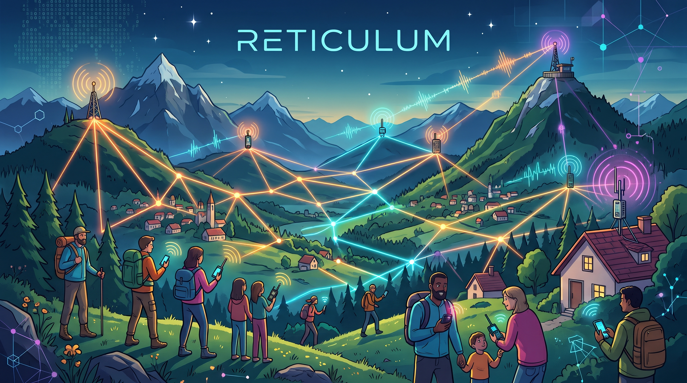
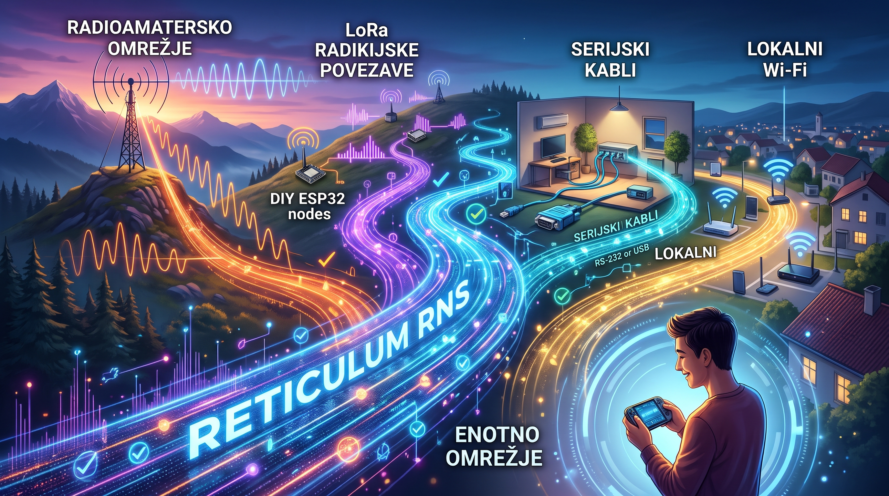
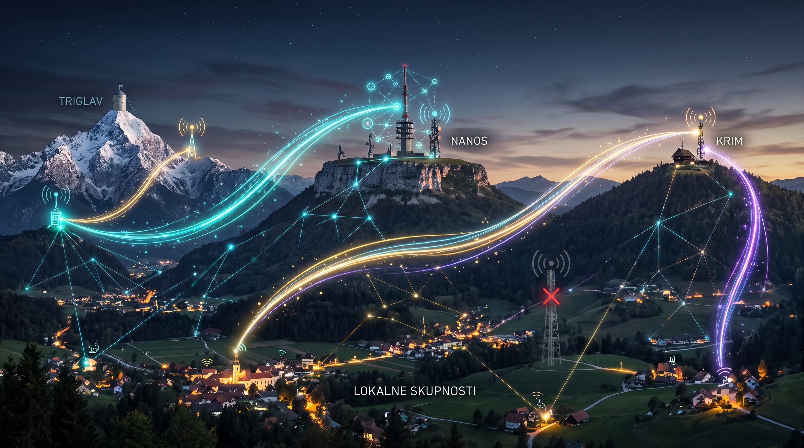

# Reticulum: Omrežje prihodnosti, ki pripada ljudem



*Ilustracija: Reticulum kot omrežje, ki povezuje ljudi in lokalne skupnosti.*

Večina ljudi danes internet dojema kot nekaj samoumevnega. Pošiljamo sporočila, beremo novice, opravljamo bančne storitve in komuniciramo z ljudmi po vsem svetu. V ozadju pa se skriva dejstvo, da je velika večina naše digitalne komunikacije odvisna od centralizirane infrastrukture, velikih korporacij in sistemov, nad katerimi nimamo nobenega nadzora.

Vsak dan uporabljamo storitve, kot so Gmail, WhatsApp, Facebook Messenger, Instagram, Telegram in številne druge platforme. Za vsako potrebujemo ločen račun, geslo, telefonsko številko ali elektronski naslov. Naše identitete so razdrobljene med stotine različnih ponudnikov, ki hranijo naše podatke in določajo pravila komunikacije.

Toda obstaja drugačna pot. Ta pot se imenuje **Reticulum Network Stack (RNS)**.

---

## Kaj je Reticulum?

Reticulum je odprtokodni komunikacijski protokol in omrežni sklad, zasnovan za ustvarjanje decentraliziranih, varnih in odpornih komunikacijskih omrežij.

Njegov namen ni zamenjati interneta, temveč omogočiti komunikacijo med ljudmi ne glede na to, po kakšni povezavi komunicirajo.

Reticulum lahko deluje preko:
- interneta,
- Wi-Fi povezav,
- *mesh* omrežij *(omrežij, kjer naprave komunicirajo neposredno druga z drugo in si medsebojno posredujejo sporočila brez osrednjega usmerjevalnika)*,
- LoRa radijskih povezav,
- radioamaterskih omrežij,
- serijskih povezav,
- lokalnih omrežij,
- mobilnih naprav.

Za uporabnika pa vse to predstavlja eno samo omrežje.



*Ilustracija: Različni komunikacijski mediji lahko sodelujejo v enem omrežju Reticulum.*

---

## Internet je omrežje lokacij, Reticulum je omrežje identitet

Klasični internet temelji na lokaciji. Vsaka naprava potrebuje:
- IP naslov,
- domeno,
- strežnik,
- vrata.

Ko želimo vzpostaviti povezavo, moramo vedeti, kje se nekdo nahaja.

Reticulum uporablja povsem drugačen pristop — namesto lokacij uporablja **identitete**.

Vprašanje ni več: *Kje se nahaja računalnik?*
Temveč: *Kdo je oseba ali naprava, s katero želim komunicirati?*

Omrežje nato samo poišče pot do te identitete.

| Lastnost | Klasični internet | Reticulum (RNS) |
| :--- | :--- | :--- |
| **Naslavljanje** | Lokacija (IP naslov, domena) | Identiteta (javni ključ) |
| **Računi** | Ločen račun za vsako storitev | Ena identiteta za vse |
| **Šifriranje** | Dodatno (TLS, VPN, aplikacije) | Privzeto vgrajeno |
| **Odvisnost** | Operaterji, strežniki, DNS | Deluje čez poljuben medij |

---

## Ena identiteta za vse življenje

Ko v Reticulumu ustvariš identiteto, nastane kriptografski par ključev:
- **zasebni ključ**,
- **javni ključ**.

Ta identiteta je:
- enolična,
- globalno prepoznavna,
- kriptografsko zaščitena,
- neodvisna od infrastrukture,
- neodvisna od ponudnika.


*Ilustracija: Kriptografski ključi so temelj uporabnikove digitalne identitete.*

Ustvariš jo enkrat. In ostane tvoja.

- Ni je treba znova ustvarjati za vsako storitev.
- Registracija ni potrebna.
- Odobritev ni potrebna.
- Ni centralnega registra.

---

## Primerjava z resničnim svetom

Predstavljajmo si absurdno situacijo. Greš v trgovino in tam moraš ustvariti nov račun. Nato greš na pošto in ponovno ustvariš nov račun. Kasneje obiščeš knjižnico — spet nov račun, novo uporabniško ime in novo geslo.

To je natanko tisto, kar danes počnemo na internetu.

Reticulum deluje drugače — podobno kot osebna izkaznica v resničnem svetu. Imaš eno identiteto in z njo se predstavljaš povsod:
- v banki,
- na pošti,
- v knjižnici,
- na upravni enoti.

Ne potrebuješ nove identitete za vsako institucijo. Reticulum uvaja podobno logiko v digitalni svet.

---

## Konec neskončnega števila gesel

Današnji internet od uporabnika zahteva:
- stotine uporabniških računov,
- desetine gesel,
- obnovitvene kode,
- potrditve po elektronski pošti,
- dvofaktorsko prijavo.

To ustvarja ogromno kompleksnosti. Reticulum vse to poenostavi. Tvoja identiteta je dokaz, da si ti. Omrežje lahko kriptografsko preveri avtentičnost identitete brez:
- uporabniškega imena,
- gesla,
- registracije,
- centralnega ponudnika.

Zasebni ključ ostane pri uporabniku. S tem odpade velik del težav, ki jih danes poznamo:
- kraje gesel,
- vdori v uporabniške baze,
- pozabljena gesla,
- centralizirane baze uporabnikov.

> **Pomembno glede varnostnih kopij:** Ker v Reticulumu ni centralnega ponudnika in gumba »Pozabljeno geslo«, si za svoj zasebni ključ odgovoren sam. Če napravo izgubiš ali se pokvari brez varnostne kopije ključa, svoje identitete ni mogoče obnoviti.

---

## Zasebnost je vgrajena že od začetka

V današnjem internetu je zasebnost pogosto dodatna možnost. Potrebujemo:
- VPN,
- dodatne varnostne nastavitve,
- posebne aplikacije,
- plačljive storitve.

Pri Reticulumu je zasebnost osnovna lastnost sistema. Omrežju ni pomembno:
- tvoje ime,
- naslov,
- telefonska številka,
- elektronski naslov.

Pozna zgolj tvojo identiteto. Komunikacija je privzeto šifrirana in ne potrebuješ dodatnih nastavitev.

---

## Kako Reticulum najde uporabnika?

Ko se identiteta pojavi v omrežju, **vozlišča** *(naprave v omrežju, ki sprejemajo, pošiljajo ali posredujejo pakete)* objavljajo tako imenovane **pakete za najavo (*announce*)**. Ta vozlišča si med seboj zapomnijo poti.

**Primer:**

```text
Ljubljana
    │
Vrhnika
    │
Logatec
    │
Postojna
```

Če se uporabnik nahaja v Postojni, omrežje samodejno ugotovi najprimernejšo pot. Pošiljatelju ni treba vedeti:
- IP naslova,
- fizične lokacije,
- uporabljene tehnologije.

Dovolj je identiteta.


*Ilustracija: Ob razpoložljivih alternativnih povezavah lahko komunikacija poteka tudi mimo izpadlega dela infrastrukture.*

---

## Identiteta ostane enaka povsod

To je ena najpomembnejših prednosti Reticuluma.

Danes:
- zamenjaš ponudnika interneta → spremeni se IP naslov,
- preseliš se → spremeni se omrežje,
- zamenjaš telefon → pogosto se spremeni način dostopa.

V Reticulumu ostane identiteta enaka. Danes si lahko:
- doma na optiki,
- jutri na LoRa omrežju,
- pojutrišnjem na Wi-Fi *mesh* omrežju,
- naslednji teden na radioamaterski povezavi.

Omrežje še vedno ve, kdo si. Poišče zgolj novo pot do tebe.


*Ilustracija: Identiteta ostane ista tudi ob spremembi lokacije ali vrste povezave.*

---

## Kako Reticulum zavrača neveljaven promet?

Ena največjih prednosti Reticuluma je njegova učinkovitost. Vozlišče ne sprejema vsega prometa in ne posluša naključno celotnega omrežja. Preverja:
- strukturo paketov,
- tip paketa,
- kriptografske podpise,
- veljavnost destinacij.

Če paket ni skladen s protokolom Reticulum:

> **DROP** — se preprosto zavrže.

To velja za:
- IPv4,
- IPv6,
- DNS,
- ARP,
- ICMP,
- HTTP promet.

S tem se zmanjša:
- obremenitev omrežja,
- poraba energije,
- možnost zlorab,
- nepotreben promet.

To je posebej pomembno pri počasnih povezavah, kot je LoRa.


*Ilustracija: Preverjanje veljavnosti paketov in zavračanje prometa, ki ni skladen s protokolom.*

---

## Kaj lahko v praksi počnemo na Reticulumu?

Reticulum ni zgolj teorija ali omrežni eksperiment — na njem že danes deluje več uporabnih odprtokodnih aplikacij:
- **Sideband** in **MeshChat:** aplikaciji za šifrirano besedilno sporočanje, skupinske klepete, pošiljanje slik in glasovne klice (delujeta na računalnikih in telefonih Android).
- **NomadNet:** orodje za ustvarjanje in brskanje po decentraliziranih besedilnih straneh, forumih in sporočilnih tablah brez osrednjih strežnikov.
- **Prenos datotek in telemetrija:** izmenjava manjših datotek ter zbiranje podatkov s senzorjev (npr. vremenskih postaj) na oddaljenih lokacijah.


*Ilustracija: Sporočanje z aplikacijami, kot sta Sideband in MeshChat, prek razpoložljivih radijskih povezav tudi brez interneta; prikaz vmesnika je shematski.*

---

## Zakaj je LoRa tako zanimiva?

LoRa omogoča komunikacijo na velikih razdaljah z zelo majhno porabo energije. Prav LoRa je ena najzanimivejših tehnologij za gradnjo neodvisnega Reticulum omrežja.

Pri tem je dobro vedeti, kakšne so njene realne zmogljivosti: LoRa zaradi zelo nizkih prenosnih hitrosti ni namenjena pretakanju videa ali prenosu velikih datotek, je pa idealna za besedilna sporočila, izmenjavo lokacij, telemetrijo in zanesljivo komunikacijo ob izpadih elektrike ali interneta. Reticulum je zasnovan tako, da tudi na tako počasnih povezavah deluje izjemno varčno.

Najlepše pa je, da oprema ni draga. Danes je mogoče kupiti osnovno ESP32 LoRa ploščo (brez ohišja in večje antene) za približno **30 €**.

Primeri naprav:
- Heltec LoRa,
- LilyGO T-Echo,
- LilyGO T-Beam,
- RAK Wireless sistemi,
- druge ESP32 LoRa platforme.

Že ena takšna naprava lahko postane polnopravno vozlišče v omrežju Reticulum.


*Ilustracija: Zamisel varčnega LoRa vozlišča z neodvisnim napajanjem za uporabo na terenu.*

> **Kaj pa Meshtastic?** Če že poznate naprave Heltec ali LilyGO, ste morda slišali za *Meshtastic*. Medtem ko je Meshtastic namenjen predvsem kratkim sporočilom znotraj LoRa *mesh* omrežja, je Reticulum splošen kriptografski omrežni sklad. Ta zna promet samodejno usmerjati in povezovati čez različne medije hkrati (npr. LoRa, Wi-Fi, lokalno omrežje in internet) v eno samo omrežje.

---

## Deluje skoraj povsod

Reticulum ni vezan na enega proizvajalca, en operacijski sistem ali eno vrsto naprave. Deluje na:
- Windows,
- Linux,
- macOS,
- Android,
- Raspberry Pi,
- tablicah,
- strežnikih,
- mobilnih telefonih,
- LoRa napravah.

Vsak lahko začne z opremo, ki jo že ima.

---

## Zakaj je Reticulum pomemben za Slovenijo?

Slovenija ima odlične pogoje za razvoj takšnega omrežja. Imamo:
- močno radioamatersko skupnost,
- veliko tehničnega znanja,
- številne hribe in razgledne točke,
- kratke razdalje med kraji.

Že nekaj deset strateško postavljenih vozlišč bi lahko ustvarilo zelo zmogljivo nacionalno omrežje. Predstavljajmo si vozlišča na:
- Krimu,
- Nanosu,
- Pohorju,
- Slavniku,
- Kumu,
- Triglavu,
- Črnem vrhu.

Takšno omrežje bi lahko povezovalo skupnosti po vsej Sloveniji tudi v primerih izpadov klasične infrastrukture.



*Ilustracija: Idejna zasnova povezovanja slovenskih skupnosti prek višinskih vozlišč; prikaz ni zemljevid dejanskih lokacij ali pokritosti.*

---

## Omrežje ljudi, ne korporacij

Največja vrednost Reticuluma ni tehnologija sama. Največja vrednost je filozofija:
- Komunikacija ponovno pripada uporabnikom.
- Identiteta pripada posamezniku.
- Omrežje pripada skupnosti.
- Zasebnost je privzeta.
- Varnost je privzeta.
- Ni centralne točke nadzora.
- Ni registracije.
- Ni zbiranja osebnih podatkov.
- Ni neskončnega ustvarjanja novih računov in gesel.

---

## Poziv skupnosti

Reticulum ni projekt prihodnosti. Reticulum obstaja danes.

Vsak posameznik lahko že danes:
- ustvari svojo identiteto,
- namesti programsko opremo na računalnik ali telefon (npr. **Sideband** ali **MeshChat** za hiter začetek brez programiranja),
- postavi prvo vozlišče,
- kupi LoRa napravo za približno 30 €,
- postane del nastajajočega decentraliziranega omrežja.

Če želite začeti takoj, si več informacij in dokumentacijo oglejte na uradni strani **[reticulum.network](https://reticulum.network)**.

Če bo vsak od nas prispeval le eno vozlišče, bomo skupaj ustvarili nekaj, kar presega tehnologijo. Ustvarili bomo omrežje, kjer je identiteta pomembnejša od lokacije, kjer je zasebnost privzeta in kjer komunikacija ponovno pripada ljudem.

*Reticulum ni zgolj nov omrežni protokol. Je nova miselnost. Miselnost, ki digitalni svet vrača v roke posameznika in skupnosti.*
